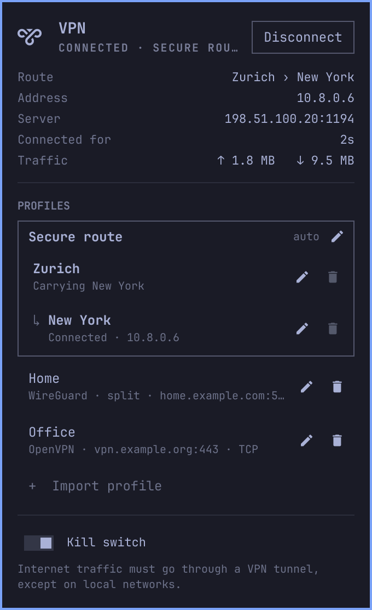

# VPN Manager for Omarchy

A small [Omarchy](https://omarchy.org) bar widget for WireGuard and OpenVPN. Import the `.conf` or `.ovpn` file your VPN provider or admin gave you, or paste its text, then connect and disconnect from the bar. Nest profiles inside each other, WireGuard and OpenVPN alike, to send your traffic through several servers in turn. Nothing needs root.



## Features

- **Bar icon:** bright when connected, dimmed when not, pulsing while it connects. It turns red when a WireGuard server isn't answering. Hover for the profile and address.
- **WireGuard and OpenVPN in one list.** Each profile says which it is, its server, and whether it carries all your traffic.
- **Import profiles** from WireGuard `.conf` and OpenVPN `.ovpn` files: pick one of the files found in `~/Downloads`, browse for one with the normal file chooser, or type a path. Certificates and keys inside an `.ovpn` file are imported with it.
- **Paste a config:** copy the config's text (from a provider's web page, a chat, a password manager), then press **Paste config** in the import box, or `p`. Pasting it into the path field works too: it's taken from the clipboard straight away, and the field is cleared. The settings open so you can name it.
- **Connect and disconnect** with a click. A WireGuard profile, or an OpenVPN one whose password is saved (or that needs none), connects straight away; an OpenVPN profile that needs a password opens a form for it. Several at once is fine, except the one that [connects automatically](#connecting-automatically), which connecting anything else disconnects. While connected, the panel shows the address, server, time connected and traffic.
- **Questions while connecting:** if an OpenVPN private key has a password, or the server sends a one-time-code challenge, the question appears in the panel. Closing the panel to copy something from another window keeps what you'd typed for two minutes.
- **Clear errors:** for OpenVPN, the panel reads OpenVPN's log while connecting and says what went wrong: a wrong password, a wrong key password, a server it can't find, a server that doesn't answer, or a certificate it can't verify. That needs your user to be able to read the system journal, which members of `wheel` can (as on a standard Omarchy install); without it, the panel gives NetworkManager's own, vaguer reason.
- **No reply from a WireGuard server:** WireGuard has no connection to set up, so NetworkManager says "connected" straight away, whether or not a server is answering. The panel watches the tunnel instead: if it has sent for 10 seconds and nothing has come back, the icon turns red and the panel says so.
- **Nest profiles inside each other** (multi-hop): drag one profile onto another, and it then connects through it. WireGuard and OpenVPN mix. Nested profiles make a group, which goes on and off as one, and which you can name. See [Nesting](#nesting).
- **Kill switch:** blocks the internet if the VPN drops, WireGuard or OpenVPN. See [Kill switch](#kill-switch).
- **Connect automatically:** one profile or group. See [Connecting automatically](#connecting-automatically).
- **Edit profiles:** rename them, and for OpenVPN, change the username, save the password or have it asked each time, and choose whether all your traffic goes through it.
- **Edit the config itself:** **Edit config…** in a profile's settings, or `c`, opens the profile as a wg-quick or `.ovpn` file in your editor, in a terminal. Change the server, keys, addresses, DNS, routes, certificates or any other option, save and quit, and the profile is updated. Its name and the rest of its settings stay as they were. If NetworkManager can't make sense of the result, the terminal says why and offers to edit again. If the profile is connected on its own, it offers to reconnect so the changes apply; one connected as part of a group isn't offered that: reconnect the group.
- **Keyboard and mouse:** everything works from either; see [Keys](#keys).

## Privacy

- The plugin only talks to NetworkManager on your machine. It makes no network connections of its own, except while a group connects: it sends a byte through each WireGuard tunnel to make it answer, to the next server or somewhere that tunnel carries, and looks a later server's name up through the tunnel before it (see [Nesting](#nesting)). None of that goes around the tunnels.
- A WireGuard private key goes from the file (or clipboard) to NetworkManager over D-Bus. It is never put on a command line, in an environment variable or in a file. Configs are parsed from memory. A pasted config goes from the clipboard straight to the backend, not through the panel. Your clipboard keeps the text until you copy something else, and **Omarchy's clipboard manager keeps a copy** in its history, private key included, in `~/.local/state/omarchy/clipboard-history.json`. To delete it, open the clipboard manager with `Super+Ctrl+V`, select the config and press `Delete`. The panel reminds you after a paste.
- A password you type goes from the password field straight to NetworkManager, through a pipe and then D-Bus, and the field is cleared once it's used. Whatever you'd typed is kept for two minutes after the panel closes, so you can go and copy a username or password from a password manager; after that, it's forgotten.
- **Edit config…** is the one time a key is in a file: a copy, readable only by you, in your runtime folder (`$XDG_RUNTIME_DIR`, which lives in memory, not on disk). It's deleted when the edit ends or the terminal is closed. If the terminal is killed outright, it's deleted on the next status check instead, and in any case when you log out. An `.ovpn` copy holds no username or password, and names certificates by path rather than holding them.
- The copy opens in your Omarchy default editor if that runs in the terminal (Neovim, Vim, nano or micro), otherwise in Neovim. The editor starts without your own config and plugins, so a plugin such as an AI completion service never sees the key. Swap, undo, history and backup files are turned off, so nothing of it is written to disk. A graphical editor isn't used, since it would keep its own copies.
- A [group](#nesting) connects in-memory copies of its profiles, keys and saved passwords included, which NetworkManager keeps in `/run` (in memory, readable only by root) and deletes as they disconnect.
- The plugin's own files are small notes in your runtime folder (`$XDG_RUNTIME_DIR`, in memory, gone when you log out), all named `omarchy-vpn-manager-…`: which profiles you disconnected (so they aren't connected automatically again), the server addresses the kill switch lets through for what's connected, which hop of a connected group is which profile, and lock files that keep two changes from running at once. None holds a key or password. Apart from those and the setup marker (see [Uninstall](#uninstall)), profiles, WireGuard keys and saved passwords are kept by NetworkManager, exactly as if you'd used `nmcli connection import`, in `/etc/NetworkManager/system-connections/`, which only root can read. Which profile is nested inside which is kept in the profiles themselves, as NetworkManager user data. Certificates and keys inside an `.ovpn` file are saved where NetworkManager's importer puts them, as files readable only by you in `~/.local/share/networkmanagement/certificates/`, as with `nmcli connection import`; removing the profile in the panel deletes them. The imported file is left where it was, so delete it if you don't need it.

## Requirements

- Omarchy with the Quickshell-based `omarchy-shell`, and NetworkManager running (it is on a standard Omarchy install).
- These packages. The plugin doesn't bundle any of them; [setup](#install) offers to install whichever are missing:
  - `networkmanager` and `python-gobject`, which come with Omarchy. WireGuard itself is part of the Linux kernel and NetworkManager, so it needs nothing else (not even `wireguard-tools`).
  - `networkmanager-openvpn`, NetworkManager's OpenVPN plugin, which also brings in `openvpn`. This is the one a standard Omarchy install doesn't have. Without it, WireGuard works and OpenVPN profiles can't be imported or connected.
  - `wl-clipboard`, for pasting a config, which comes with Omarchy.

Browse uses the desktop's file chooser (`xdg-desktop-portal-gtk`, which also comes with Omarchy). Without it, type the path or pick a file from the list instead.

### Why through NetworkManager?

- **No root to connect.** NetworkManager creates the WireGuard interface and runs `openvpn`, and your desktop session is already allowed to ask it to. `wg-quick` and `openvpn` on their own need root for every connect.
- **Routes and DNS just work.** NetworkManager already runs your network, so it sets up each tunnel's routes and DNS and puts them back afterwards.
- **Keys and passwords stay out of reach.** NetworkManager keeps them where only root can read them, or asks for a password each time.

## Install

```sh
omarchy plugin add https://github.com/fivefold3/omarchy-vpn-manager --enable
```

In a terminal, you're asked which bar section the icon goes in: left, center or right. With `--yes`, or without a terminal, it goes in the right section.

The first time the plugin loads, if any of the packages it uses are missing, a notification offers a guided setup. Clicking it, now or later from the notification history, opens a terminal that asks before each step:

1. Install the missing packages (asks for your password).
2. Choose (or change) the bar section for the icon.

Nothing changes if you dismiss or ignore the notification, and you're only asked once. The panel also shows a **Run setup** button while something it needs is missing. Run the same setup any time:

```sh
~/.config/omarchy/plugins/io.github.fivefold3.vpn-manager/vpn-nm setup
```

## Connecting automatically

One profile or group at most connects automatically: turning it on for one turns it off for the one before, and the panel says which. Rows show `auto` when it's on.

- **A WireGuard profile** is connected by NetworkManager itself: from startup, before you log in too. WireGuard doesn't need reconnecting when Wi-Fi drops or you wake from sleep: the tunnel stays up and carries on once the network is back. Turning it on for a profile that's down doesn't connect it there and then (NetworkManager starts from the next startup); connect it by hand to start now.
- **An OpenVPN profile or a group** is connected by the panel, since NetworkManager can't do either itself: when you log in, when the network comes back, and again if it drops while nothing else is connected. It needs its passwords saved, since nobody's there to type them: turning on **Connect automatically** turns on **Save password**, and turning off **Save password** turns off **Connect automatically**. If it can't connect, a notification says why once, and it tries again less and less often, up to every ten minutes, until the network next comes back.
- **Not after you've disconnected it:** a profile or group you disconnect, or set aside by connecting something else, stays off until you connect it again, or log in again (or restart, for WireGuard), but it stays set to.

Imported profiles start with it off, whatever the file says.

## Nesting

A profile nested inside another connects through it: the outer one carries its tunnel. Profiles nested one inside the next make a group, which you can name:

```
Secure route
aus
↳ zch
  ↳ usa
```

Connecting the group connects `aus` directly, then `zch` through `aus`, then `usa` through `zch`. Everything you send is wrapped three times: the Australian server sees your address and Zürich's, Zürich sees Australia's and the USA's, and only the USA server sees where your traffic goes, but not who you are. The servers can be from different providers, and WireGuard and OpenVPN mix in any order.

- **To nest a profile,** drag it onto the one it should go through. It goes in just under that one, and takes over what that one carried, so dragging `usa` onto `aus` in `aus › zch › usa` makes `aus › usa › zch`. To take it out of its group, drag it below the list, where a space appears for it while you drag, or anywhere else that isn't a profile; the profile it carried moves up to fill the gap. While you drag, a faint line starting with `↳` shows where it will go in under another profile, and the dragged profile says what will happen. With the keyboard, `→` (`l`) puts it under the profile above it and `←` (`h`) moves it up one place in its group, and from first place, out of the group; or choose in its settings, under **Through**.
- **Each profile carries one other at most,** so a group is a single route, and its last profile is where your traffic comes out.
- **A group is drawn in a box,** which lights up as a whole when you point at it or select it.
- **A group goes on and off as one:** clicking any of its profiles, or its name, connects or disconnects all of it. They can't be connected one by one.
- **In order:** each profile in the group connects once the one before it has been seen to work. While it connects, each one shows `Waiting`, then `Connecting…`, then `Carrying …` (or `Connected` for the last). If a server doesn't answer, the whole group is disconnected again, and the panel says which.
- **The group's edit button** (or `e` with the group selected) sets its name and whether it connects automatically. The name shows over the group and in the bar, and `omarchy-shell io.github.fivefold3.vpn-manager connect "<group name>"` connects it. A group connecting automatically is shown on its name as `auto`. Without a name, it goes by its route. Each profile in it keeps its own edit button.
- **An OpenVPN profile in a group needs its password saved:** nobody can type it in while the group connects. The same goes for a private key whose password is asked for each time. One that connects through an HTTP or SOCKS proxy can only be first in a group. Of an OpenVPN profile's servers, any that can't be reached through the profile before it are left out; the group only fails when none are left.
- **A group ends** when only one profile is left in it: its name and automatic connecting go with it.
- **One group at a time:** connecting another group disconnects the first. Profiles not in a group stay connected.

How it works: each profile in the chain is connected as a copy made for the occasion, so your profiles stay as they are. The copies before the last carry nothing but a route to the next server: no default route, no DNS. The last routes what its profile says, as it would on its own. Only the first server is looked up the usual way: a later server's name is looked up through the tunnel before it, with that tunnel's own DNS server, so nothing about it goes anywhere else. Each tunnel inside another is given room for the outer one's headers: a WireGuard one gets a smaller packet size, and an OpenVPN one has TCP fit inside the tunnel before it.

A group fails to connect, saying why, when a profile can't reach the next server:

- when that server isn't in a WireGuard profile's `AllowedIPs` (a provider's config normally allows everything, `0.0.0.0/0`), or when two profiles use the same server;
- when a profile inside an OpenVPN one has its server given by name rather than as an address: NetworkManager can't change an OpenVPN connection's routes once it's up, so the address has to be known before it connects;
- when a WireGuard profile has no DNS server of its own to look the next server's name up with;
- when the group is too deep for a profile with an IPv6 address (more than three hops), since each hop leaves less room for packets and IPv6 needs at least 1280 bytes.

## Kill switch

Turn on **Kill switch** at the bottom of the panel, or press `Shift+K`. While it's on, the internet only works through a VPN. If a tunnel drops, the internet is blocked instead of going out unprotected.

- It stays on after a restart, until you turn it off.
- Your local network still works: your router, printers, other computers.
- The servers (and proxy) of whatever you connect are let through, so they can be reached, and those of a WireGuard profile NetworkManager connects on its own at startup; nothing else is.
- In a group, if a middle tunnel drops, the next server can't be reached directly, so it never sees your address.
- A VPN that only carries some traffic (`split`) connects, and its own networks work; everything else stays blocked.
- **A server given by name can't be looked up** while the kill switch is on and nothing's connected, unless your DNS server is on your local network: the lookup is blocked too. Give the server as an address (most providers' files do), or turn the kill switch off to connect. Servers looked up while connecting with the kill switch off, or when you turn it on, are let through for as long as that stays connected.
- **An OpenVPN profile set up outside this panel** (with `nmcli`, another app or plugin) needs a routing table of its own to get through, which profiles imported here have; the plugin doesn't change a profile it didn't import without asking. With the kill switch on, connecting it says so: press `Enter` or click it again to give it one. It routes as before. Turning the kill switch on while one is connected says it's blocked: disconnect it and connect it again here.

How it works: it's a NetworkManager connection called **VPN kill switch**, which adds routing rules. Anything a VPN isn't carrying is sent to an "unreachable" route, unless it's for your local network or a VPN's server. No firewall or root is needed. For OpenVPN to get through, each OpenVPN profile routes through a routing table of its own, as WireGuard does; see [How it works](#how-it-works).

## Root

The plugin never needs root. The only step that asks for your password is setup installing missing packages, since they're system packages.

## Keys

| Key | Action |
|---|---|
| `↑` `↓` / `j` `k` | Move between profiles, groups, "Import profile" and the files found. The first press shows the cursor |
| `Enter` / `Space` / click | Connect or disconnect a profile or group; on one that's connecting, stop. An OpenVPN profile that needs a password opens its form; `Enter` there connects. On a file, import it |
| `→` / `l` | Put the selected profile under the one above it |
| `←` / `h` | Move the selected profile up one place in its group; from first place, out of it |
| Drag a profile | Onto another: put it in just under that one. Anywhere else: take it out of its group |
| `Enter` in a field | Connect, save the profile, or import the path typed |
| `Tab` | Move between a form's fields, **Through** and switches |
| `Space` / `Enter` on a switch | Flip it |
| `←` `→` / `Space` / `Enter` on **Through** | Pick the profile to go through |
| `e` | Edit the selected profile, or group |
| `c` | Edit the selected profile's config file |
| `i` / `n` | Open or close the import box; the path field gets the keys, and `↓` goes back to the list |
| `p` | Paste a config from the clipboard |
| `b` | Browse for a profile file |
| `x` | Remove the selected profile (press twice) |
| `Shift+K` | Turn the kill switch on or off |
| `d` | Disconnect the selected profile or group (or stop it connecting); with nothing selected, everything |
| `s` | Run setup, while something it needs is missing |
| `r` | Refresh |
| `Esc` | Cancel a connection waiting on a question, close the form or import box, or close the panel |

Right-clicking the bar icon refreshes it.

To bind a key of your own, add a line like this to `~/.config/hypr/bindings.lua`:

```lua
o.bind("SUPER + ALT + V", "VPN", "omarchy-shell shell toggle io.github.fivefold3.vpn-manager")
```

The shell also takes:

- `omarchy-shell io.github.fivefold3.vpn-manager connect "<profile or group>"`: connects it, or leaves it be if it's already up. An OpenVPN profile that needs a password opens its form instead. If connecting fails while the panel is closed, a notification says why; likewise for `disconnect`.
- `omarchy-shell io.github.fivefold3.vpn-manager importFile "<path>"`: imports a file. Give the full path: a relative one is taken from the shell's folder, not yours.
- `omarchy-shell io.github.fivefold3.vpn-manager killSwitch on` (or `off`, or `toggle`). If it fails while the panel is closed, a notification says why.
- `open`, `close`, `show`, `hide`, `disconnect` and `status`.

## Settings

| Setting | Default | |
|---|---|---|
| `refreshIntervalSec` | `10` | How often the icon checks the VPN while the panel is closed, from 3 to 300. While the panel is open, or while connecting, it checks every 2 seconds, and every second while a connect runs with the panel open. With a bar on several monitors, one icon checks for all of them. |
| `importFolder` | `~/Downloads` | Where the import box looks for `.conf` and `.ovpn` files, and where the file chooser starts. |

Change them with `omarchy bar set`; the bar picks the change up straight away:

```sh
omarchy bar set io.github.fivefold3.vpn-manager refreshIntervalSec 30 --json
omarchy bar set io.github.fivefold3.vpn-manager importFolder "~/VPN"
```

Each check runs `nmcli` twice, once more per OpenVPN connection, and reads the tunnels' counters from `/sys`, and the note a group's connect left of which profile each hop is.

## Uninstall

```sh
omarchy plugin remove io.github.fivefold3.vpn-manager
```

**Turn the kill switch off first.** Otherwise it keeps blocking the internet after the plugin's gone. If you forgot, run `nmcli connection delete "VPN kill switch"`.

That takes the icon out of the bar. What stays behind:

- **Your profiles,** in NetworkManager, where `nmcli connection` lists them and `nmcli connection delete "<profile>"` removes one, or remove them in the panel first, which also deletes the certificate files their import extracted. A WireGuard profile set to connect automatically keeps doing so without the plugin. A nested profile keeps a note of which profile it's nested in, and an OpenVPN profile set to connect automatically a note of that, which nothing but the plugin reads. Each OpenVPN profile keeps its own routing table, which routes as before.
- **The packages** setup installed, such as `networkmanager-openvpn`. Remove them with `omarchy pkg remove networkmanager-openvpn` if nothing else needs them.
- **A marker** that remembers the setup offer was made. To remove it: `rm -rf ~/.local/state/omarchy-vpn-manager`.

## How it works

- `Panel.qml` is the bar icon and panel.
- `vpn-nm` is a Bash script with an embedded Python helper. Status, and connecting and disconnecting a profile on its own, go through `nmcli`; the rest (listing, importing, saving, removing, groups and the kill switch) through libnm, NetworkManager's own library. The script also works on its own:

```sh
vpn-nm status                 # key<TAB>value lines, plus one "vpn" line per active VPN connection
vpn-nm profiles               # one TSV line per profile, each followed by those nested inside it
vpn-nm move <uuid> [[--above] <uuid>]   # move one profile just under another, as in a list; with one, out
vpn-nm group <uuid> <name> [<autoconnect 1|0>]  # name the group the profile is in
vpn-nm killswitch on|off      # internet only through a VPN
vpn-nm import <file>...       # prints each new profile's uuid
vpn-nm import-text [name]     # imports a config read from stdin
vpn-nm paste [name]           # imports the config on the clipboard
vpn-nm candidates [dir]       # WireGuard and OpenVPN files found in dir
vpn-nm browse [dir]           # file chooser; prints the chosen paths
vpn-nm save <uuid> <name> <autoconnect 1|0> [--via <uuid>] [--user-stdin] [--password save|ask] [--password-stdin] [--all-traffic 1|0]
vpn-nm remove <uuid>
vpn-nm connect [--auto] <uuid> [--user-stdin] [--save|--ask] [--password-stdin] [--own-table]
                              # stdin: the username, then the password, as asked for
vpn-nm disconnect [uuid]      # a profile in a group takes all of it down
vpn-nm edit <uuid>            # in a terminal: the profile's config in your editor
vpn-nm setup
```

**Importing** uses NetworkManager's own parsers, for wg-quick files and `.ovpn` files (the ones behind `nmcli connection import`), but adds the profile itself, so it starts with the settings the plugin wants: not connecting automatically (`nmcli connection import` adds a WireGuard profile with autoconnect on, and NetworkManager connects it within a millisecond), and for OpenVPN, a routing table of its own. The parsers read a file and name things after it, so they read an in-memory copy behind a link with the right name: for WireGuard, the interface's (the file's own name when that's a valid, unused interface name, as wg-quick does, otherwise `wg0`, `wg1` and so on); for OpenVPN, the new profile's, since NetworkManager saves certificates inside the file as `<name>-ca.pem` and so on, and would overwrite another profile's of the same name. Certificate and key files an `.ovpn` file names by path are found next to the file, as `openvpn` finds them, and the profile goes on using them where they are: moving or deleting them breaks it.

**Connecting an OpenVPN profile** runs `nmcli --ask connection up` on a pseudo-terminal. It types in a password from the panel when NetworkManager asks for one, and passes any other question (key password, one-time code) up to the panel. While connecting, it follows OpenVPN's log to explain failures, reading only the lines from this connection's own `openvpn`.

**OpenVPN's routing table:** NetworkManager puts a WireGuard full tunnel's routes in a table of their own, looked up for everything except the tunnel's own packets, after the main table's own more specific routes. An OpenVPN profile normally uses the main table, where the kill switch, which hides the main table's default route, would block it. So each OpenVPN profile the plugin imports gets a table of its own too, looked up the same way (for unmarked packets, after the main table's own more specific routes): routing is as before, but the kill switch lets it through, and a group's WireGuard packets never go into it. One imported some other way gets it only when you say so (see [Kill switch](#kill-switch); `vpn-nm connect <uuid> --own-table`). A profile with routing of its own (a table or routing rules set by hand) is left alone. In a group, the copies are set up this way whatever the profile is, and the profile itself is left as it is.

**Groups** connect a copy of each profile, added in memory and made volatile, so NetworkManager deletes it when it disconnects; a copy left by a connect that was cut short is deleted on the next connect or disconnect. Each copy before the last has a route to the next server and nothing else. When the last takes all traffic, it's looked up for everything not marked with the group's firewall mark, which every WireGuard copy marks its own packets with, so each tunnel's packets go into the one before it, and the first one's go out to the network. An OpenVPN copy inside a WireGuard one connects over it, so NetworkManager's own route to its server goes through it too. Each tunnel inside another is given room for the outer one's headers: a WireGuard one's MTU is 60 bytes less (80 over IPv6), and an OpenVPN one clamps TCP to fit.

**No reply** from a WireGuard server is worked out from the interface's counters in `/sys/class/net`: bytes sent, but none received, for 10 seconds from when the panel first saw it. That needs no root, unlike `wg show`, which is the only other way to see the last handshake. The time connected is the interface's age, since NetworkManager creates it on connect and deletes it on disconnect.

## Limitations

- **WireGuard's `PreUp`, `PostUp`, `PreDown`, `PostDown` and `SaveConfig`, and OpenVPN's `up` and `down` scripts, are ignored**, as with any NetworkManager import. The rest of the file is imported. Comments aren't kept either, so **Edit config…** shows the settings without them.
- **Some `.ovpn` directives aren't supported** by NetworkManager's importer: they're left out, and the rest of the file is imported. A file NetworkManager can't make sense of at all isn't imported, and the panel shows its reason. `static-challenge` (a one-time code asked for alongside the password) isn't supported by NetworkManager's OpenVPN plugin; servers that send a *dynamic* challenge work, and the code is asked for in the panel.
- **A saved OpenVPN password that the server refuses** ends the attempt with an error rather than asking again, because NetworkManager doesn't ask for a password it keeps itself. Type the new one in its settings.
- **A WireGuard server that stops answering later** isn't spotted: once anything has come back through the tunnel, the counters can't tell a quiet tunnel from a dead one without root. **A server name that doesn't resolve** isn't spotted either: nothing is sent at all, which looks the same as a quiet tunnel.
- **Which traffic goes through a WireGuard tunnel** is decided by the file's `AllowedIPs`; change it with **Edit config…**. Rows show `split` unless IPv4 internet traffic goes through it. For OpenVPN, it's **Send all traffic through the VPN** in its settings.
- **Files already imported** still show in the import box's list. Importing one again makes a second profile, named with a number.
- **A server whose address changes while a group is up** isn't followed: the group looked it up when it connected. Reconnect. **Nesting changed while a group is up** applies the next time it connects.
- **Keys NetworkManager doesn't keep:** a WireGuard profile made outside the plugin whose private key is asked for at connect time can't be opened with **Edit config…**, or be part of a group, since there's no key to use.

## License

MIT. "WireGuard" and the WireGuard logo are registered trademarks of Jason A. Donenfeld; "OpenVPN" and the OpenVPN logo are registered trademarks of OpenVPN Inc. This plugin isn't affiliated with either.
